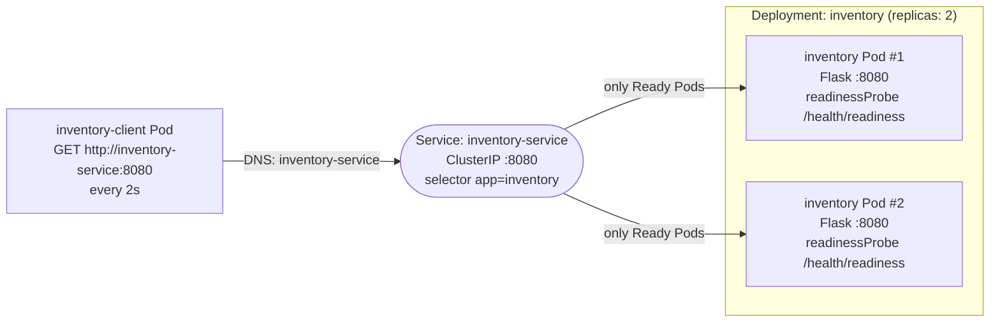
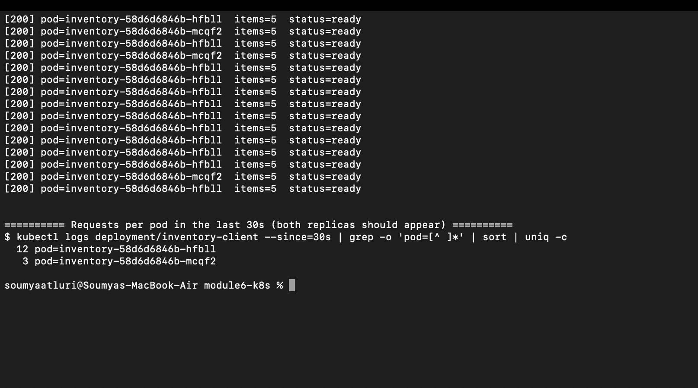

# Module 6 – Kubernetes Service Discovery, Readiness & Pod Replacement

A small Flask **Inventory Service** runs as 2 replicas behind a Kubernetes **Service**. A **client** Pod calls the Inventory Service every 2 seconds **using only the Service name** (`http://inventory-service:8080`) and logs which Pod answered. This shows how Kubernetes handles service discovery, readiness, and Pod replacement.

## Repository layout

```
inventory-service/   Flask app (/, /health/readiness, /health/liveness, /toggle-ready) + Dockerfile
client/              Python client that calls the Service every 2s + Dockerfile
k8s/
  inventory-deployment.yaml   Deployment, 2 replicas, readiness + liveness probes
  inventory-service.yaml      ClusterIP Service "inventory-service" on port 8080
  client-deployment.yaml      Client Deployment, INVENTORY_URL=http://inventory-service:8080
scripts/run-demo.sh  Runs all three tests and saves output to evidence/
evidence/            Terminal output captured by run-demo.sh
screenshots/         Screenshots of the system working
```

## Architecture



- The client never uses Pod IPs, only the DNS name `inventory-service`.
- The Service sends traffic only to Pods whose readiness probe passes (its *endpoints*).
- The Deployment keeps 2 replicas running and replaces any Pod that is deleted.

## How to deploy

Tested with **Docker Desktop Kubernetes** (kind-based cluster, Kubernetes v1.36.1). minikube also works; see the note below.

1. Turn on Kubernetes: Docker Desktop → Settings → Kubernetes → **Enable Kubernetes** → Apply & restart.
2. Build the images:
   ```bash
   kubectl config use-context docker-desktop
   docker build -t inventory-service:latest ./inventory-service
   docker build -t inventory-client:latest ./client
   ```
3. Load the images into the cluster node. The manifests use `imagePullPolicy: Never`, so the images must already be on the node. Docker Desktop's kind-based cluster doesn't share images with `docker build`, so copy them in:
   ```bash
   docker save inventory-service:latest inventory-client:latest -o /tmp/inventory-images.tar
   docker cp /tmp/inventory-images.tar desktop-control-plane:/inventory-images.tar
   docker exec desktop-control-plane ctr -n k8s.io images import /inventory-images.tar
   ```
   (Skip this step if your Docker Desktop cluster uses Kubeadm, which shares images automatically.)
4. Deploy:
   ```bash
   kubectl apply -f k8s/
   kubectl rollout status deployment/inventory
   kubectl get pods,svc,endpoints
   ```
5. Watch the client:
   ```bash
   kubectl logs -f deployment/inventory-client
   ```
6. Run all three tests and save the evidence:
   ```bash
   ./scripts/run-demo.sh
   ```

**minikube instead:** run `minikube start`, build the images as above, then run `minikube image load inventory-service:latest` and `minikube image load inventory-client:latest` instead of step 3.

**Cleanup:** `kubectl delete -f k8s/`

### Making a Pod fail readiness by hand

```bash
POD=$(kubectl get pods -l app=inventory -o jsonpath='{.items[0].metadata.name}')
kubectl exec $POD -- python -c "import urllib.request as u; print(u.urlopen(u.Request('http://localhost:8080/toggle-ready', method='POST')).read().decode())"
```
Run the same command again to make it ready again.

## Results

All output below comes from `./scripts/run-demo.sh`, run on Docker Desktop Kubernetes (v1.36.1) on Nov 4, 2026. The full, unedited logs are in [`evidence/`](evidence/), and screenshots are in [`screenshots/`](screenshots/).

### 1. Deployment: both replicas running, client uses the Service name

Both Inventory Pods are `Running` and Ready, and the Service `inventory-service` has both Pod IPs as endpoints ([full log](evidence/01-service-and-replicas.txt)):

```text
$ kubectl get pods -l app=inventory -o wide
NAME                         READY   STATUS    RESTARTS   AGE   IP            NODE
inventory-58d6d6846b-hfbll   1/1     Running   0          16m   10.244.0.18   desktop-control-plane
inventory-58d6d6846b-mcqf2   1/1     Running   0          16m   10.244.0.19   desktop-control-plane

$ kubectl get service inventory-service
NAME                TYPE        CLUSTER-IP    EXTERNAL-IP   PORT(S)    AGE
inventory-service   ClusterIP   10.96.63.83   <none>        8080/TCP   16m

$ kubectl get endpoints inventory-service
NAME                ENDPOINTS                           AGE
inventory-service   10.244.0.18:8080,10.244.0.19:8080   16m
```

The client is configured with the **Service name only**, not Pod IPs:

```text
$ kubectl get deployment inventory-client -o jsonpath={.spec.template.spec.containers[0].env}
[{"name":"INVENTORY_URL","value":"http://inventory-service:8080"},{"name":"INTERVAL_SECONDS","value":"2"}]
```

**Both replicas receive requests.** The client log shows responses from both Pods:

```text
$ kubectl logs deployment/inventory-client --tail=15
[200] pod=inventory-58d6d6846b-hfbll  items=5  status=ready
[200] pod=inventory-58d6d6846b-mcqf2  items=5  status=ready
[200] pod=inventory-58d6d6846b-hfbll  items=5  status=ready
[200] pod=inventory-58d6d6846b-mcqf2  items=5  status=ready
...
$ kubectl logs deployment/inventory-client --since=30s | grep -o 'pod=[^ ]*' | sort | uniq -c
  12 pod=inventory-58d6d6846b-hfbll
   3 pod=inventory-58d6d6846b-mcqf2
```

The Service picks a backend at random for each new connection, so the split isn't exactly 50/50. Both replicas serve traffic.

### 2. Readiness test

**Failure.** Pod `inventory-58d6d6846b-hfbll` was made unready by calling its `/toggle-ready` endpoint ([full log](evidence/02-readiness-failure.txt)). The readiness probe started returning 503:

```text
$ kubectl exec inventory-58d6d6846b-hfbll -- POST http://localhost:8080/toggle-ready
{"pod":"inventory-58d6d6846b-hfbll","ready":false}

Warning  Unhealthy  0s (x3 over 5s)  kubelet  Readiness probe failed: HTTP probe failed with statuscode: 503
```

The Pod is **still Running** (0 restarts), but it is **not Ready** and has been **removed from the Service endpoints**:

```text
$ kubectl get pods -l app=inventory -o wide
NAME                         READY   STATUS    RESTARTS   AGE   IP
inventory-58d6d6846b-hfbll   0/1     Running   0          17m   10.244.0.18
inventory-58d6d6846b-mcqf2   1/1     Running   0          17m   10.244.0.19

$ kubectl get endpoints inventory-service
NAME                ENDPOINTS          AGE
inventory-service   10.244.0.19:8080   17m
```

The **other ready Pod keeps serving every request**. In 30 seconds, all 15 requests went to `mcqf2` and none to the unready Pod:

```text
$ kubectl logs deployment/inventory-client --since=30s | grep -o 'pod=[^ ]*' | sort | uniq -c
  15 pod=inventory-58d6d6846b-mcqf2
```

**Recovery.** Readiness was restored on the same Pod ([full log](evidence/03-readiness-recovery.txt)). It went back to `1/1`, its IP returned to the endpoints, and it started receiving traffic again:

```text
$ kubectl exec inventory-58d6d6846b-hfbll -- POST http://localhost:8080/toggle-ready
{"pod":"inventory-58d6d6846b-hfbll","ready":true}

$ kubectl get pods -l app=inventory -o wide
NAME                         READY   STATUS    RESTARTS   AGE   IP
inventory-58d6d6846b-hfbll   1/1     Running   0          17m   10.244.0.18
inventory-58d6d6846b-mcqf2   1/1     Running   0          17m   10.244.0.19

$ kubectl get endpoints inventory-service
NAME                ENDPOINTS                           AGE
inventory-service   10.244.0.18:8080,10.244.0.19:8080   17m

$ kubectl logs deployment/inventory-client --since=30s | grep -o 'pod=[^ ]*' | sort | uniq -c
   3 pod=inventory-58d6d6846b-hfbll
  12 pod=inventory-58d6d6846b-mcqf2
```

### 3. Pod failure and recovery

Pod `inventory-58d6d6846b-hfbll` was deleted ([full log](evidence/04-pod-replacement.txt)). The Deployment **immediately created a replacement** with a **new name and IP** while the old Pod was terminating:

```text
$ kubectl delete pod inventory-58d6d6846b-hfbll --wait=false
pod "inventory-58d6d6846b-hfbll" deleted

$ kubectl get pods -l app=inventory -o wide
NAME                         READY   STATUS        RESTARTS   AGE   IP
inventory-58d6d6846b-cfxtw   0/1     Running       0          3s    10.244.0.20
inventory-58d6d6846b-hfbll   1/1     Terminating   0          18m   10.244.0.18
inventory-58d6d6846b-mcqf2   1/1     Running       0          18m   10.244.0.19
```

Once the new Pod passed readiness, it joined the Service endpoints. **The Service name and ClusterIP did not change:**

```text
$ kubectl get endpoints inventory-service
NAME                ENDPOINTS                           AGE
inventory-service   10.244.0.19:8080,10.244.0.20:8080   18m

Deleted pod:          inventory-58d6d6846b-hfbll
Replacement pod:      inventory-58d6d6846b-cfxtw
Service before:       inventory-service 10.96.63.83
Service after:        inventory-service 10.96.63.83
```

The **client kept working through the same Service name**, with no changes, and requests now reach the new Pod `cfxtw`:

```text
$ kubectl logs deployment/inventory-client --since=30s | grep -o 'pod=[^ ]*' | sort | uniq -c
   6 pod=inventory-58d6d6846b-cfxtw
   9 pod=inventory-58d6d6846b-mcqf2
```

### Screenshots

**1. Both Inventory Pods `1/1 Running`, the `inventory-service` ClusterIP Service, and both Pod IPs as endpoints**


**2. The client reaches both replicas through the Service name**



**3. Readiness failure: `hfbll` is still `Running` but `0/1` Ready, and only `mcqf2` is left in the endpoints**


**4. While `hfbll` is unready, all client requests go to the ready Pod `mcqf2`**


**5. Readiness restored: both Pods `1/1`, two endpoints, and traffic reaches `hfbll` again**


**6. After deleting `hfbll`, the Deployment immediately creates `cfxtw`, a new name and IP**


**7. Same Service name and ClusterIP after replacement, and the client keeps working with the new Pod `cfxtw`**


## Reflection: why a stable Service name is useful

Pods are temporary: they get new names and IP addresses whenever they are restarted, rescheduled, or replaced, as the Pod deletion test showed. If the client called Pod IPs directly, it would break every time a Pod changed. The Service gives a single, stable DNS name and ClusterIP that stay the same while the Pods behind it come and go. Kubernetes keeps the Service's endpoints up to date automatically, adding Pods when they become Ready and removing them when they fail readiness or are deleted. As a result, the client needs no code or configuration changes and keeps working through failures and recoveries.
