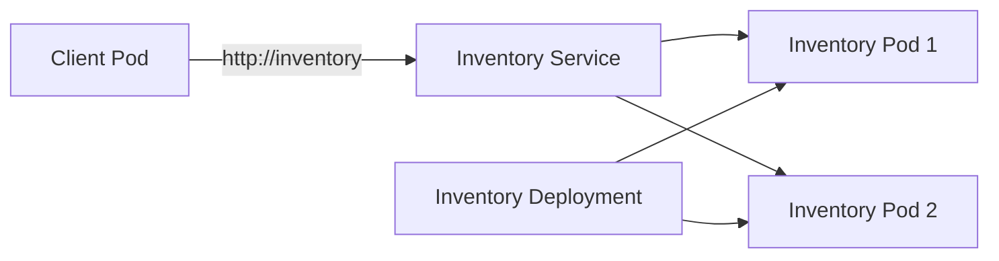

# Kubernetes Inventory Service Lab

This project demonstrates Kubernetes service discovery, readiness probes, load balancing across replicas, and Pod replacement after failure.

The application consists of:

- An `inventory` Deployment with two replicas.
- An `inventory` ClusterIP Service that provides a stable DNS name.
- A client Deployment that sends requests to `http://inventory` using the Service name.

## Architecture



The client never uses an individual Pod IP or Pod name. Kubernetes DNS resolves the Service name `inventory`, and the Service forwards traffic only to ready Pods.

## Prerequisites

Install one Kubernetes environment:

- [Minikube](https://minikube.sigs.k8s.io/docs/start/)
- [Kind](https://kind.sigs.k8s.io/docs/user/quick-start/)
- Docker Desktop with Kubernetes enabled

Also install `kubectl` and verify access:

```bash
kubectl version --client
kubectl get nodes
```

## Project Structure

The repository should use the following structure:

```text
.
├── inventory-service/
│   ├── app.py
│   ├── Dockerfile
│   └── requirements.txt
├── client/
│   ├── client.py
│   ├── Dockerfile
│   └── requirements.txt
├── k8s/
│   ├── inventory-deployment.yaml
│   ├── inventory-service.yaml
│   └── client-deployment.yaml
└── README.md
```

The evidence files requested by the assignment can be added later in an optional `evidence/` directory. The commands below assume the exact filenames shown above.

## Expected Kubernetes Resources

### `inventory-service/app.py`

The Inventory application should provide these HTTP endpoints:

- `GET /` — returns a response identifying the Inventory Pod that handled the request.
- `GET /health` — returns HTTP 200 while the process is alive.
- `GET /ready` — returns HTTP 200 when the Pod is ready and a non-200 response when readiness is intentionally disabled.

The response from `/` should include the Pod identity. The Deployment passes the Kubernetes Pod name through the `POD_NAME` environment variable.

### `inventory-service/Dockerfile` and `requirements.txt`

The Inventory Dockerfile should install the dependencies from `requirements.txt`, copy `app.py`, expose port `8080`, and start the web server on `0.0.0.0:8080`.

### `k8s/inventory-deployment.yaml`

Create a Deployment named `inventory` with:

- `replicas: 2`
- Label `app: inventory`
- A container that listens on port `8080`
- A readiness probe that checks `GET /ready` on port `8080`
- A liveness probe that checks `GET /health` on port `8080`
- The application response should identify the serving Pod.

Example container configuration:

```yaml
apiVersion: apps/v1
kind: Deployment
metadata:
  name: inventory
spec:
  replicas: 2
  selector:
    matchLabels:
      app: inventory
  template:
    metadata:
      labels:
        app: inventory
    spec:
      containers:
        - name: inventory
          image: inventory-service:latest
          ports:
            - name: http
              containerPort: 8080
          env:
            - name: POD_NAME
              valueFrom:
                fieldRef:
                  fieldPath: metadata.name
          readinessProbe:
            httpGet:
              path: /ready
              port: http
            initialDelaySeconds: 2
            periodSeconds: 3
          livenessProbe:
            httpGet:
              path: /health
              port: http
            initialDelaySeconds: 5
            periodSeconds: 10
```

If you use a different image tag, update `k8s/inventory-deployment.yaml` and the image-build commands consistently.

### `k8s/inventory-service.yaml`

Create a Service named `inventory` that selects the two Deployment Pods:

```yaml
apiVersion: v1
kind: Service
metadata:
  name: inventory
spec:
  type: ClusterIP
  selector:
    app: inventory
  ports:
    - name: http
      port: 80
      targetPort: http
```

Inside the cluster, the client can call the application with:

```text
http://inventory
```

The full DNS name is also available:

```text
http://inventory.default.svc.cluster.local
```

### `client/client.py`, `client/Dockerfile`, and `client/requirements.txt`

The client should send repeated HTTP requests to the value of the `INVENTORY_URL` environment variable and print each response.

Its dependencies and startup command belong in the client Dockerfile and requirements file.

### `k8s/client-deployment.yaml`

The client should run inside the cluster and send repeated requests to the Service name:

```yaml
apiVersion: apps/v1
kind: Deployment
metadata:
  name: inventory-client
spec:
  replicas: 1
  selector:
    matchLabels:
      app: inventory-client
  template:
    metadata:
      labels:
        app: inventory-client
    spec:
      containers:
        - name: client
          image: inventory-client:latest
          env:
            - name: INVENTORY_URL
              value: http://inventory
```

The client must not contain a hard-coded Pod IP or Pod name. Its output should display the response from the Inventory application, including the serving Pod identity.

## Deployment Instructions

### 1. Start the cluster

Use the command for your selected Kubernetes environment.

```bash
# Minikube
minikube start

# Kind
kind create cluster --name inventory-lab
```

For Docker Desktop, enable Kubernetes through Docker Desktop settings and wait until the cluster reports `Running`.

Confirm the active context:

```bash
kubectl config current-context
kubectl get nodes
```

### 2. Build or load images

For Minikube:

```bash
eval "$(minikube docker-env)"

docker build -t inventory-service:latest ./inventory-service
docker build -t inventory-client:latest ./client
```

For Kind:

```bash
docker build -t inventory-service:latest ./inventory-service
docker build -t inventory-client:latest ./client

kind load docker-image inventory-service:latest --name inventory-lab
kind load docker-image inventory-client:latest --name inventory-lab
```

If the images are hosted in a registry, push them and update the image references in:

```text
k8s/inventory-deployment.yaml
k8s/client-deployment.yaml
```

### 3. Apply the Kubernetes manifests

```bash
kubectl apply -f k8s/inventory-deployment.yaml
kubectl apply -f k8s/inventory-service.yaml
kubectl apply -f k8s/client-deployment.yaml
```

These manifests use the default namespace unless a namespace is explicitly added to the YAML files.

Wait for the Deployments:

```bash
kubectl rollout status deployment/inventory
kubectl rollout status deployment/inventory-client
```

Check the resources:

```bash
kubectl get pods -o wide
kubectl get service inventory
kubectl get endpoints inventory
```

The expected initial state is two Running and Ready Inventory Pods, with two endpoints listed for the Service.

## Test 1: Service Discovery and Replica Traffic

Check the client logs:

```bash
kubectl logs -f deployment/inventory-client
```

The client should call:

```text
http://inventory
```

It must not call an individual Pod IP or Pod name.

Run multiple requests:

```bash
kubectl exec deployment/inventory-client -- sh -c 'for i in $(seq 1 20); do wget -qO- http://inventory; echo; done'
```

Verify the Inventory Pods:

```bash
kubectl get pods -l app=inventory -o wide
kubectl get endpoints inventory -o wide
```

Expected result:

- Both Inventory Pods are Running and Ready.
- The client communicates using the Service name.
- Responses show requests being handled by both Inventory Pod identities.
- The Service has both ready Pods as endpoints.

Because Service routing is not guaranteed to alternate perfectly on every request, run several requests and record the distinct Pod identities observed.

### Evidence to add

```text
<!-- Add a screenshot or terminal output showing two Running/Ready Pods. -->
<!-- Add client output showing responses from both Pod identities. -->
<!-- Add Service and endpoint output showing the stable Service name. -->
```

## Test 2: Readiness Failure and Recovery

Identify the two Inventory Pods:

```bash
kubectl get pods -l app=inventory
```

Choose one Pod and make it fail readiness.

If the application uses a file-based readiness switch, run:

```bash
kubectl exec POD_TO_TEST -- sh -c 'touch /tmp/not-ready'
```

The application should return a non-success status from `/ready` while `/tmp/not-ready` exists.

If your application uses another readiness mechanism, document that mechanism and use the corresponding command.

Observe the state:

```bash
kubectl get pods -l app=inventory -w
kubectl describe pod POD_TO_TEST
kubectl get endpoints inventory -o wide
```

Expected result:

- The selected Pod remains Running.
- The selected Pod becomes `0/1 Ready`.
- The unready Pod is removed from the Service endpoints.
- The other ready Pod remains available.

Send requests during the readiness failure:

```bash
kubectl exec deployment/inventory-client -- sh -c 'for i in $(seq 1 10); do wget -qO- http://inventory; echo; done'
```

Expected result: normal Service traffic is handled by the remaining ready Pod.

The unready Pod may still be reachable directly for diagnostic purposes, but it should not receive normal traffic through the `inventory` Service.

Restore readiness:

```bash
kubectl exec POD_TO_TEST -- sh -c 'rm -f /tmp/not-ready'
kubectl wait --for=condition=Ready pod/POD_TO_TEST --timeout=60s
kubectl get endpoints inventory -o wide
```

Run the client again:

```bash
kubectl exec deployment/inventory-client -- sh -c 'for i in $(seq 1 20); do wget -qO- http://inventory; echo; done'
```

Expected result: the restored Pod becomes ready again and can receive Service traffic.

### Evidence to add

```text
<!-- Add output showing the selected Pod is Running but NotReady. -->
<!-- Add endpoint output showing that the unready Pod was removed. -->
<!-- Add client output showing the remaining ready Pod serving requests. -->
<!-- Add output showing readiness restored and the endpoint returned. -->
```

## Test 3: Pod Deletion and Replacement

List the current Inventory Pods:

```bash
kubectl get pods -l app=inventory
```

Save one Pod name and delete it:

```bash
POD_TO_DELETE=$(kubectl get pods -l app=inventory -o jsonpath='{.items[0].metadata.name}')

echo "Deleting $POD_TO_DELETE"

kubectl delete pod "$POD_TO_DELETE"
```

Watch Kubernetes create the replacement:

```bash
kubectl get pods -l app=inventory -w
```

Then verify the final state:

```bash
kubectl rollout status deployment/inventory
kubectl get pods -l app=inventory -o wide
kubectl get service inventory
kubectl get endpoints inventory -o wide
```

Expected result:

- The deleted Pod terminates.
- The Deployment creates a replacement Pod.
- The replacement has a different generated Pod name.
- The `inventory` Service name remains unchanged.
- The Service ClusterIP remains unchanged.
- Once the replacement passes readiness, it becomes a Service endpoint.

Confirm that the client continues working through the same Service name:

```bash
kubectl rollout status deployment/inventory-client

kubectl exec deployment/inventory-client -- sh -c 'for i in $(seq 1 20); do wget -qO- http://inventory; echo; done'
```

Expected result: the client continues to communicate with the Inventory application through `http://inventory`, even though one backend Pod was deleted and replaced.

### Evidence to add

```text
<!-- Add output before deletion showing the original Pod name. -->
<!-- Add output showing the deleted Pod and replacement Pod with a different name. -->
<!-- Add Service output proving that the Service name remained inventory. -->
<!-- Add client output after replacement proving continued communication. -->
```

## Useful Diagnostic Commands

```bash
kubectl get all
kubectl get pods -l app=inventory -o wide
kubectl describe deployment inventory
kubectl describe service inventory
kubectl describe pod POD_NAME
kubectl logs POD_NAME -c inventory
kubectl get endpoints inventory -o yaml
kubectl get events --sort-by=.lastTimestamp
```

To clean up the lab:

```bash
kubectl delete -f k8s/client-deployment.yaml
kubectl delete -f k8s/inventory-service.yaml
kubectl delete -f k8s/inventory-deployment.yaml
```

## Results and Evidence

Place screenshots, logs, and terminal transcripts in the `evidence/` directory. Each evidence item should include a short caption explaining which requirement it proves.

Suggested evidence files:

```text
evidence/
├── screenshots/
│   ├── initial-two-ready-pods.png
│   ├── service-endpoints.png
│   ├── readiness-failure.png
│   ├── readiness-recovery.png
│   └── pod-replacement.png
└── logs/
    ├── replica-traffic.txt
    ├── readiness-test.txt
    └── pod-replacement.txt
```

Replace this section with links or embedded images after performing the lab. Do not claim a result until the corresponding screenshot or terminal output has been added.

## Reflection

A stable Kubernetes Service name is useful because clients can communicate with one consistent DNS name even when the Pods behind it are recreated. Pods are temporary, and their IP addresses and names can change after failures, rescheduling, or rolling updates. The Service provides a stable virtual endpoint and continuously updates its endpoints based on Pod readiness. This allows the client to continue working without knowing about Pod replacement or maintaining Pod-specific addresses.

## Submission

Submit only the URL of the GitHub repository.

Ensure that the repository contains:

- The application source code.
- Dockerfiles and requirements files.
- Kubernetes manifests.
- This README.
- Screenshots, logs, and terminal evidence.
